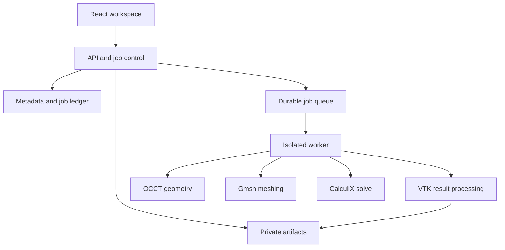

# Architecture — proposed implementation baseline

2026-10-13. T001 provides health API/UI; T007 adds persistent owner-scoped metadata/sessions and T008 adds sandboxed STEP inspection, confirmed immutable artifacts and actual vtk.js face selection; T002 provisions isolated native tools. T003–T005 provide real synthetic CAD/mesh/load/CCX/stress and limited experimental bond diagnostics. T006 adds immutable synthetic cleanup previews and measured near-5k/25k/100k meshes, small/medium solves and software WebGL diagnostics. The [M0 owner decision](docs/validation/M0-owner-decision.md) permits M1 progression with formal benchmark and laptop acceptance deferred. General connection support and the full application pipeline remain open. This stage ends at the validated local prototype through M4/T030, with AWS backend work later.

## Shape of the system

Use a TypeScript browser client, a Python API/control service, and isolated native engineering workers. Keep a modular monolith for metadata and orchestration; do not introduce Kubernetes, microservices per feature, Redis, or a distributed scheduler for five testers. Local and hosted modes share domain logic and worker protocols.

## Proposed stack and justification

| Layer | Choice | Reason / validation boundary |
|---|---|---|
| UI | React, TypeScript, Vite; accessible headless components; CSS tokens | Familiar maintainable app workflow; exact versions locked at bootstrap |
| Client state | Zustand for view/edit state; TanStack Query for server state | Separate unsaved editing from authoritative revisions/jobs |
| 3D | vtk.js single shared viewport | Scientific rendering; custom face picking and result provenance; section cuts involving volume interpolation remain server-side |
| API | FastAPI, Pydantic, SQLAlchemy, Alembic | Typed contracts, Python engineering integration, migration discipline |
| Metadata | SQLite WAL locally and initial single-control-host beta | Simple low cost; transactional queue; no DB file on shared network storage; migrate to PostgreSQL only with a justified concurrency need |
| CAD | Open CASCADE via an OCP Python binding, isolated from mesher | STEP/BREP validation and defeaturing; bindings/build must pass M0 |
| Mesh | Gmsh native/Python API in a separate process | Quadratic tetrahedra and sizing fields; face transfer must be proven |
| Solver | Pinned CalculiX CCX CPU build, initial candidate 2.23 | Fixed solver; open-source sparse solver build only; record compile options and linear algebra backend |
| Postprocess | Python NumPy + native VTK, tested CCX parser | Preserve authoritative volume data and generate display surfaces/slices |
| Reports | Shared report model; HTML/Jinja + print-to-PDF; python-docx | One data source for PDF and Word; no LLM needed |
| Local artifacts | Filesystem under configured data root | Offline local operation after dependency provisioning |
| Hosted artifacts | Private regional S3 | Durable India-region outputs with scoped access |
| Beta runtime | Small always-on control host; one on-demand EC2 On-Demand worker | Retains project access while expensive compute is idle; cost fit is a launch gate |
| Provisioning | OpenTofu, shell/bootstrap scripts, OCI images | Open-source IaC, reproducibility; no credentials in application code |

These are choices, not claims that a specific version combination is already compatible. The OCCT binding and Gmsh can bundle different OCCT versions: never load both into one interpreter. Transfer versioned files and explicit geometry maps through adapters. Dependency-license review precedes public redistribution.

## Repository layout to implement

- apps/web/src/{workspace,geometry,materials,connections,mesh,loads,runs,results,reports,auth}
- services/api/app/{routes,auth,domain,persistence,jobs,metering,storage}
- services/worker/worker/{geometry,meshing,calculix,postprocess,reports,limits}
- packages/contracts/ — generated TypeScript from API schemas plus semantic fixtures
- tests/{unit,integration,native,e2e,security,fixtures,benchmarks}
- scripts/{codex,dev,ci,validation}; infra/{local,aws}; migrations/
- docs/ and root orchestration files from this kit

Avoid generic plugin systems before a second implementation exists. Each adapter has a typed request/result contract so underlying tooling can evolve without leaking into the UI.

## Geometry and mesh pipeline

STEP upload -> checksum and unit inspection -> OCCT import/validity -> immutable BREP revision and face/body catalog -> tessellation with per-triangle face IDs. Apply repair/defeaturing to a copy; show geometric differences before commit. Undo selects an earlier revision, never mutates an existing run.
Export canonical geometry for Gmsh; reconstruct CAD-to-mesh mapping using verified body/face signatures, adjacency and geometric checks. Preserve catalog identifiers through physical groups only after one-to-one mapping validation. Ambiguous mappings stop assignment transfer; proximity alone is insufficient.
Mesh each bonded body independently for nonconforming tie validation; do not fuse bodies and pretend material interfaces are bonded constraints. Export nodes, C3D10 connectivity, boundary faces, body memberships and original face membership. Validate quadratic Jacobians and applied selections after meshing.

## Solve and result pipeline

Freeze analysis+geometry+mesh+rate snapshot -> preflight -> deterministic CCX input -> isolated ccx execution -> exit/log validation -> parse .frd/.dat and required outputs -> canonical numerical arrays -> display derivatives -> verification metrics -> report/export readiness. An exit code alone is not success.
The FRD stream must not be assumed to contain unaveraged integration-point stresses. M0 must prove extraction of element-associated stress through the pinned build's supported output requests; DAT or another documented channel may be required. Derived display interpolation and extrapolation are labeled and tested. Never present smoothed nodal values as raw element results.

## Job control

SQLite owns a durable jobs table with atomic claims, global execution lease, attempt fencing token, heartbeat, cancellation state and artifact manifests. Control-plane API is the only metadata writer for a remote worker; workers never mount the SQLite file. Claim/publish endpoints use short-lived job-scoped worker credentials. Every completion checks the current lease token.
One heavy engineering job at a time in local mode and beta. Geometry edits and reports have bounded subprocess limits too; expensive geometry jobs may enter the same queue to protect the control host. The product charge policy remains mesh/solve-only, with geometry/report cost allocated to overhead.
Job transition contract is in API_CONTRACT.md. A stale worker may not publish or charge after lease loss. The scheduler must confirm old process termination or isolate/stop its instance before retrying; a heartbeat timeout by itself is not permission to run a second solver.

## Storage and reproducibility

Content-address immutable geometry, mesh, decks and output artifacts; mutable metadata references versions. Each run records model JSON, units, selected face IDs, hash manifest, material source snapshot, tool/container hashes, solver configuration, warnings, user cap, rate card and attempt ledger.
Separate small permanent run records from expiring large meshes/fields/raw logs; retained decks can also be large, so archive contents declare exactly what expires. Preserve sufficient versioned setup to regenerate; do not promise bit-identical remeshing across missing tools/hardware. Results marked expired cannot be used to generate new numerical reports without a rerun or restored archive.

## Authentication and environments

Local mode: single user, localhost bind, no Google/AWS required. Beta: Google OIDC authorization-code flow, server verification, allowlist, secure cookie sessions, owner checks for every row and artifact. Dev bypass refuses non-loopback beta config. Cloud development uses synthetic fixtures and mock identity, never production credentials or user files.

## Hosted trade-offs

Default candidate region ap-south-1; use only India regions after verifying all chosen services. No public CAD CDN, cross-region replication, external analytics, or error SaaS receiving model data. Google auth identity traffic is disclosed separately; it is not CAD processing. Codex Cloud is a development environment, not India-hosted production infrastructure.
The ₹3,000 target is not an AWS guarantee: fixed host, disks, public IPv4, logs, backups, transfer, taxes and startup waste count. Application-level reserve/stop enforcement and an independent worker TTL watchdog limit exposure. AWS Budgets is secondary delayed monitoring. If fixed costs do not fit, do not silently change the region, use Spot, or suspend 24/7 access; present measured options.

## Implementation gates

M0 proves CAD/mesh mapping, ties, raw stress extraction, open-source dependency builds and resource behavior. M1 builds one genuine local vertical slice. Later milestones layer assemblies, reliability, reporting and AWS. Every gate carries executed evidence or remains pending.

T004 development now demonstrates native global DAT S/COORD, explicitly averaged FRD and element-owned linear extrapolation/probes for affine C3D10. VTK duplicates points at material interfaces; standalone HTML/SVG proves minimal display semantics. The vtk.js product viewer/full flow remain later work. See [ADR-012](docs/adr/ADR-012.md); engineering-owner acceptance is open.

T005 development validates an experimental consistent planar mortar connection through CCX *EQUATION for the two-block patch. Native node-to-face *TIE failed the frozen patch and is retained as rejected. Independent body/face IDs and meshes are preserved; geometry audits use a narrow binary-coordinate reader. Larger/general connections and physical gaps remain unvalidated. See [ADR-013](docs/adr/ADR-013.md); owner acceptance is open.

T007 storage and local access semantics are specified in [ADR-015](docs/adr/ADR-015.md); its completed metadata slice does not implement the later engineering workflow.

T008 import/picking and namespace/resource decisions are in [ADR-016](docs/adr/ADR-016.md). Its synchronous bounded inspection is not the later durable mesh/solve queue.

T009 now persists canonical per-body materials and display preferences in immutable analysis revisions. Reviewed sample versions/provenance are copied, unit-only changes preserve all physical/source values exactly, and assignments resolve against the analysis's pinned geometry. The real browser restores that geometry on analysis selection; new imports do not repin it. [ADR-017](docs/adr/ADR-017.md) and [T009 evidence](docs/validation/T009.md) describe the boundary. Actual load/deck/run/results integration remains T010–T012.
