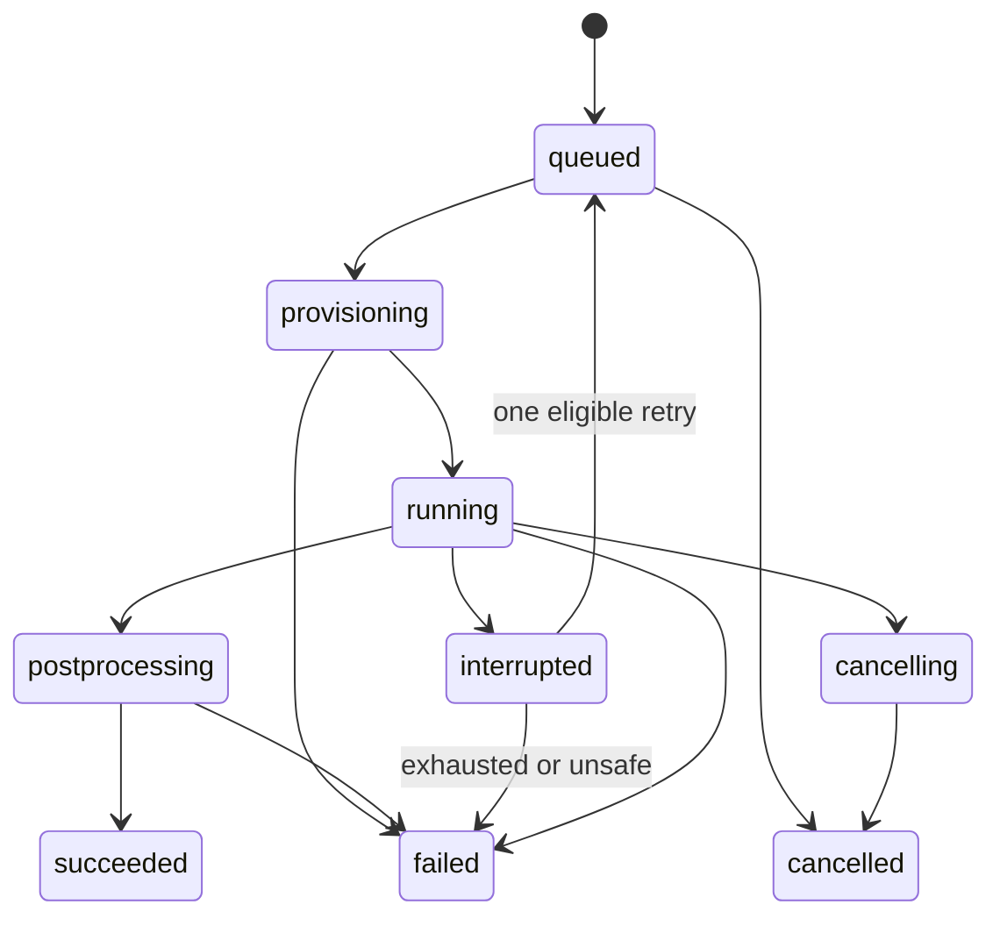

# API and job contract

Version prefix /api/v1. This is a design contract; generate OpenAPI during implementation. Session cookies with CSRF protection for mutations, owner checks on every lookup, pagination and request size limits. JSON errors: code, message, field_errors, retryable, request_id. Never return stack traces or filesystem paths.

## Implemented T007 slice

The generated OpenAPI/TS contracts now include real local session, project CRUD, geometry metadata reads and draft analysis creation/read/name-edit/history routes. All other routes below remain design targets. See [local API usage](PERSISTENCE.md), [ADR-015](adr/ADR-015.md) and [T007 evidence](validation/T007.md).

GET `/session` sets the local HttpOnly SameSite=Strict cookie and returns the persistent owner/CSRF token. Owned routes require that cookie; mutations also require `X-CSRF-Token`. APIKey cookie security and the CSRF header appear in OpenAPI. Loopback peer/Host and browser Origin checks apply even to session/health/docs. Foreign origins and cross-site fetches are rejected. Sessions expire when the API process restarts; metadata persists. Hosted modes/local bypass remain disabled.

Project PATCH/DELETE and analysis PATCH require `If-Match: "<revision>"`; absent is 428, malformed 422, stale 409. GET/create/edit return ETags. POST `/projects/{id}/analyses` requires the project ETag but does not increment it. Project metadata edits and trusted internal geometry registration increment the project revision; analysis edits increment only that analysis. Draft geometry may be null; a supplied reference must belong to the same owned nondeleted project. Name-only edits append immutable history; GET `/analyses/{id}/revisions/{revision}` reads it. Duplication/engineering settings/run snapshots remain later tasks.

GET `/projects/{id}/geometry` and `/geometry/{revision}` read immutable metadata. There is no public registration/upload/import endpoint until T008 validates artifact bytes/native CAD. Project DELETE tombstones access to the project and children; actual job cancellation/purge awaits the job implementation. Lists return items/total/offset/limit (default 50, maximum 100). POST/PATCH/PUT metadata requests require Content-Length and are bounded to 64 KiB before parsing (411/413). Unknown fields are rejected; body/path/SQL details are not echoed in errors.

## Implemented T008 slice

Owned upload tickets, bounded raw PUT bytes, synchronous native inspection and explicit confirmation/display routes are now implemented through the real UI/API. See [STEP import](STEP_IMPORT.md) and [ADR-016](adr/ADR-016.md). Inspection creates a persisted record with processing/needs_units/ready/failed/committed states; 201 can describe a failed inspection and never implies accepted geometry. Confirmation requires dimensions_confirmed=true and the inspection/project's unchanged ETag; repeat confirmation of that same committed record returns its original geometry. Bounded geometry edits are implemented as documented below; broader hosted worker/compute routes remain design targets.

Raw upload Content-Length must match its ticket and stay ≤16 MiB; actual stream bytes/hash are checked. Metadata remains capped at 64 KiB. Missing source units require an explicit choice before transfer; declared/mixed/unsupported conflicts refuse. One import process runs at a time (429 otherwise), with no automatic retry. Source/canonical/per-body BREP and two display artifacts are private, immutable, hash-checked and owner scoped. GET /geometry/{id}/display?lod=coarse|fine returns real metre-coordinate triangles and immutable catalog IDs. The viewer uses actor-to-face mapping, not triangle IDs as saved identity. New imports do not repin analyses; a revision/tombstone race prevents promotion.

## Implemented T009 slice

Authenticated GET `/unit-presets` and `/material-library` provide explicit SI factors and sourced templates without user confirmation. GET `/analyses/{id}/materials` (or `/revisions/{revision}/materials`) returns immutable saved setup and pinned per-body prerequisites. PATCH `/analyses/{id}/display-units` with `{preset}` copies all SI/source material fields exactly. PUT `/analyses/{id}/materials/{body_id}` assigns a reviewed sample/version or validated custom values/provenance; DELETE removes the assignment. These writes require the analysis ETag/CSRF, append one analysis/setup revision atomically, and leave project/geometry references unchanged. Name edits carry setup forward. Foreign/deleted analyses, bodies outside pinned geometry, stale revisions, unconfirmed/invalid/unsupported values and changed reviewed library versions refuse.

See [materials/units guide](MATERIALS_UNITS.md), [ADR-017](adr/ADR-017.md), generated contracts and [T009 evidence](validation/T009.md). E/yield are Pa, density kg/m³; source values and provenance are frozen. Missing density/yield leave gravity/yield-factor prerequisites unavailable. No run/results, load application or automatic repinning is introduced. Older metadata revisions without material setup rows read as explicit empty default-unit setups.

## Implemented T010 slice

GET `/analyses/{id}/loads` (or `/revisions/{revision}/loads`) returns pinned saved assignments, per-assignment/native CAD area/force/moment, glyph directions, combined resultant/moment, export blockers and warnings. POST `/analyses/{id}/loads` takes `{assignment:{kind,name,geometry_revision_id,face_ids,...}}`: `fixed` has no quantity fields; `pressure` adds `units,pressure`; `force` adds `units,force:[x,y,z]`. Distinct overlapping loads require `combine_confirmed:true`; unconfirmed overlap is 409. DELETE `/analyses/{id}/loads/{assignment_id}` removes one saved assignment. Writes require CSRF/analysis ETag and append immutable analysis/material/load rows. Geometry UUID and catalog IDs must belong to the pinned revision; duplicate IDs count once. No transient tags, point loads, remote moments or user-authored decks are accepted.

POST `/analyses/{id}/deck-exports` requires CSRF/analysis ETag and returns 201 export metadata only after actual bounded isolated Gmsh meshing and deck validation. It does not append an analysis revision or submit a solve. Identical frozen snapshot/tool policy reuses verified artifacts; stale/tombstoned input after native completion refuses publication. GET `/analyses/{id}/deck-exports` lists the latest 100 records; GET `/deck-exports/{id}` reads metadata. Owned GET `/deck-exports/{id}/input` downloads fixed-name `analysis.inp`; `/snapshot` downloads canonical frozen input/policy JSON. SHA-256 identities appear in metadata; corrupted artifact reads/cache hits return 503. Old downloads retain their original inputs after later edits/restarts. Limits: independent bodies, ≤100 planar faces, ≤3,000 affine C3D10 elements, 60 seconds/1,536 MiB RSS/192 MiB scratch; unsupported mapping/geometry/load export returns 422, a concurrent native import/mesh returns 429. No automatic retries/healing/coarsening.

See [face loads/deck guide](LOADS_DECKS.md), [ADR-018](adr/ADR-018.md), generated contracts and [T010 evidence](validation/T010.md). Normals must be native verified; pre-T010 geometry needs reimport for pressure. Export snapshots are immutable; durable solve/run jobs remain T011.

## Implemented T011 slice

POST `/analyses/{id}/mesh-jobs` with `{}` and POST `/analyses/{id}/runs` with `{mesh_job_id}` return 202 durable job metadata and a job Location. Both require CSRF/analysis ETag/UUID Idempotency-Key (missing 428, invalid 422). Identical same-owner key/request replays its original job even after head edits; changed payload is 409. A run requires a completed mesh from the same analysis/geometry/tool contract, then freezes regenerated current deck/setup against that connectivity without remeshing. Pending/active cap is 20 (429); fixed planar/affine/3,000-element policy remains. No raw deck/caller command/sizing/billing input is accepted.

GET `/analyses/{id}/jobs` lists the newest 100; `/jobs/{id}` returns actual status/stage/times/heartbeat, original revision/geometry/input hash, warnings, artifacts and events; `/jobs/{id}/events` returns owned history. POST `/jobs/{id}/cancel` requires CSRF, independent of mutable-analysis ETag: pending cancellation is immediate, active stays cancelling until death, terminal calls replay. Owner/tombstone/attempt checks apply throughout. Restart fences interrupted processes before resuming pending jobs, without automatic retry.

GET `/jobs/{id}/mesh-display` returns actual tri6-derived display/catalog references for successful meshes. GET `/jobs/{id}/artifacts/{filename}` downloads only fixed-name snapshot/mesh/input/log/resource/DAT/FRD/parsed output with hash/size checks; corruption is 503. Snapshot is available from admission; results.json requires validated success. Failed/cancelled/interrupted files are diagnostic. GET `/local-worker` reports ready/waiting/blocked state. No browser timer implies completion. Hosted worker credentials/billing below remain planned. See [guide](LOCAL_JOBS.md), [ADR-019](adr/ADR-019.md), generated contracts and [evidence](validation/T011.md). Calculated result views are T012.

## Implemented T016 slice

POST `/analyses/{id}/direction-previews` accepts `{geometry_revision_id,directions:[{kind,reference_id,reverse}]}` (1–200 selections) and returns native signed `DirectionSnapshot` values: pinned geometry UUID, source kind/reference, vector, right-handed basis and origin. Kind is `plane_normal`, `straight_edge` or `cylinder_axis`. This owned, CSRF/ETag-guarded POST is read-only: no revision, native job or load is created. Stale/foreign geometry/reference, curved edge, invalid/singular direction and absent legacy data refuse.

POST `/analyses/{id}/loads` accepts `directional_force` with `face_ids,units,magnitude,direction` and `symmetry` with complete planar `face_ids`. Displacement accepts exactly one existing `axis` or native `direction`, plus `units,displacement`. Requests cannot submit bases. Saved assignments retain native/source fields and `review_direction`; symmetry retains one resolved native normal per face. New geometry responses include body-owned `edges`/`vertices` with incidence and line endpoints, plus native cylinder-axis signature fields. Legacy catalog defaults are empty; missing native source data requires reimport.

Cleanup invalidates all geometry-derived directions and withholds arrows/resultants. PUT `/analyses/{id}/loads/{assignment_id}/faces` explicitly reselects targets; symmetry recomputes its normals. PUT `/analyses/{id}/loads/{assignment_id}/direction` with `{geometry_revision_id,direction,reviewed:true}` then rebinds a pending directional assignment after target review, preserving source magnitude/units. All writes append owned ETag/CSRF-guarded immutable rows; old runs remain unchanged and undo cannot overwrite later edits.

Node constraints deduplicate consistent rows and refuse contradictions/ill-conditioned bases. A single combined rectangular transform per node governs local boundaries/CLOAD. DAT/FRD explicitly output global vectors; local output fails validation. External RF-minus-written-applied reactions project onto the constrained span. Equilibrium criteria and force-on-constrained-component refusal remain unchanged. Snapshot policy/source fingerprints freeze the direction contract, while read-only views reconstruct actual written frames. [Guide](GEOMETRY_DIRECTIONS.md), [ADR-024](adr/ADR-024.md), generated contracts and [evidence](validation/T016.md) define the bounded affine/planar path; cylindrical-axis setup does not authorize curved solving.

## Implemented T015 slice

POST `/analyses/{id}/loads` also accepts `displacement` with `face_ids,axis:x|y|z,units,displacement` (zero allowed; other components free), and `gravity` with `body_ids,units,acceleration:[x,y,z]` (nonzero global vector). Both retain immutable SI/source values. Gravity bodies require density/native volume centre for known weight and solve/export. Missing density withholds the complete assignment preview and sets `resultant_complete:false`; zero weight is never fabricated. Overlapping body accelerations require explicit combination. Conflicting shared global node/DOF values refuse; equal values deduplicate. CAD support rank is necessary coverage only, confirmed again on actual mesh.

PUT `/analyses/{id}/loads/{assignment_id}/bodies` with `{geometry_revision_id,body_ids}` explicitly reviews/rebinds gravity after cleanup while retaining acceleration/source quantities. It requires owned live analysis, CSRF and matching ETag. Face component reselection follows the existing face route. Old body refs are never automatically repinned after changed mass/centre; undo restores captured controls in a fresh revision.

Load state returns force/moment reference magnitudes, characteristic length, known mass and gravity/component markers. New geometry body display retains optional native `center_m`; legacy missing centres require reimport for gravity. Solve snapshot/deck freezes versioned equilibrium policy. Native density/GRAV and inside-step nonzero BOUNDARY retain written SI physics. Run summaries and read-only results include `equilibrium`: applied/reaction force/moment, origin, actuator scale and separate force/moment residual/reference/criterion/tolerance/pass fields. Absolute checks carry `relative_residual:null`. Both certificates must pass before successful publication; failures retain diagnostic outputs as `equilibrium_failed`. Existing frozen raw sources remain unchanged. [Guide](ESSENTIAL_LOADS.md), [ADR-023](adr/ADR-023.md), generated schemas and [evidence](validation/T015.md) define exact fields and limits.

## Implemented T014 slice

Owned GET `/analyses/{id}/mesh-controls` returns the saved immutable SI/source setup, current analysis ETag, resolved body sizes, planning element/node/DOF estimates, unchanged native limits, blockers/warnings and optional coarsening proposal. POST `/analyses/{id}/mesh-controls/preview` requires CSRF/analysis ETag and computes without saving; PUT `/analyses/{id}/mesh-controls` appends one analysis/material/load/mesh revision. Payload is `{units,global_size:null|positive,local_sizes:[{kind:body|face,entity_id,size}],curvature_elements:0|8..64,recovery_enabled:boolean}`. Unique pinned CAD references and finite >=1e-9-m sizes are required; face sizes refine the resolved body size. Stale ETag is 409; invalid selections/sizes are 422. Intentional oversize controls may be saved, but admission returns 422 `mesh_controls_blocked`; the proposal is never applied by the server.

The T011 mesh route now freezes these settings and allows mesh inspection before material/load completion. Unreviewed cleanup assignments still block. Mesh generation supports at most 100 plane/cylinder faces and 3,000 C3D10 cells; solve/deck export retain validated planar/affine and complete-setup requirements. Solve additionally compares physical saved global/local SI sizes and curvature with the selected mesh (`incompatible_mesh_controls` 422), exact geometry and current source/tool policy. Display-unit or recovery-permission changes alone do not change physical sizing compatibility. Existing immutable snapshots read with explicit legacy sizing defaults.

GET `/jobs/{id}/mesh-display` additionally returns recomputed full-domain quality and all-cell quadratic `quality_display`; succeeded meshes and retained failed diagnostic meshes are inspectable. Red failure blocks solving. Maximum three explicitly permitted mesh profiles retain exact settings, geometry and quality thresholds. Progress reports attempt/profile; terminal summary and `recovery.json` preserve all outcomes. Fixed download names now include `recovery.json`, `mesh-attempt-1.log` through `mesh-attempt-3.log`, and corresponding `mesh-attempt-N-resources.json`. Mesh-only success requires verified snapshot/mesh/log/resources/recovery plus accepted host quality; a deck is available only for complete supported affine setup. A solve still requires complete checked deck, native/parsed results and finish validation. Mapping/corruption/resource/cancel/interruption failures never qualify for recovery; there are no solver retries. Explicit saved permission also governs synchronous deck-export meshing; healing/coarsening remain prohibited.

See [mesh guide](MESH_CONTROLS.md), [ADR-022](adr/ADR-022.md), generated contracts and [T014 evidence](validation/T014.md).

## Planned service routes

| Method and route | Behavior |
|---|---|
| POST /projects; GET /projects | Create/list own projects |
| GET/PATCH/DELETE /projects/{id} | Authorized details, revision-guarded edit, tombstone/cancel |
| POST /projects/{id}/geometry-uploads | Constrained STEP upload ticket with checksum/size ceiling |
| POST /projects/{id}/geometry-imports | Queue validated import from completed owned upload |
| POST /geometry/{revision}/edits | Preview repair/defeaturing in a copy |
| POST /geometry/{revision}/edit-commits | Commit a verified preview with parent revision check |
| POST /projects/{id}/analyses | New analysis pinned to geometry revision |
| GET/PATCH /analyses/{id} | Typed settings; If-Match revision required on mutation |
| POST /analyses/{id}/duplicate | Duplicate immutable references and editable state |
| GET /analyses/{id}/preflight | Structured blockers, warnings and selected-geometry checks |
| POST /analyses/{id}/estimates | Stage, revision and resource plan -> expiring estimate/rate ID |
| POST /analyses/{id}/mesh-jobs | Estimate ID, revision, cap, idempotency key -> reservation/job |
| POST /analyses/{id}/runs | Frozen mesh+analysis revision, estimate/cap -> run/job |
| GET /jobs/{id}; GET /jobs/{id}/events | Durable state; SSE with event IDs or polling fallback |
| POST /jobs/{id}/cancel | Idempotent request; consumption stops on actual termination |
| GET /runs/{id}/results | Manifest of authorized fields/location types and expiry |
| POST /runs/{id}/sections | Bounded server-side slice request; cache by plane/run/field |
| POST /runs/{id}/reports | Selected views, format, user conclusion, immutable report request |
| POST /projects/{id}/exports | Portable archive options; owner rechecked when download issued |
| POST /archive-imports | Safe archive import into a new private project |
| GET /usage; GET /allowance | Actual, credited, reserved and remaining quantities separately |
| POST /admin/allowances | Operator allocation only, no implicit project-content access |

Use 409 for stale revision/idempotency payload conflict, 422 for invalid engineering setup, 403 for forbidden action, 404 for inaccessible object where appropriate, 429 for quotas. An estimate is not permission to execute and becomes stale when inputs/resources/rate version change. A duplicate idempotency key with same payload returns original job; a different payload conflicts.

## State transitions

Terminal jobs cannot become running again; retry creates a new Attempt beneath the same logical Job and changes job state under a guarded transaction. Stage-specific statuses include budget_exceeded, resource_exceeded and invalid_model as failure reasons. Failed postprocessing is a platform failure; retry postprocessing without rerunning CCX when raw artifacts are sound.
A compute watchdog uses monotonic elapsed time, reserved rate, termination latency and startup margin. Cancellation is “requested” until process/instance death is confirmed. Terminal successful state requires validated output manifest and atomic usage finalization. SSE disconnect is not a job-state transition.

## Implemented T012 core results

Owned GET `/runs/{job_id}/results` returns a typed versioned SI derivative only for a succeeded local solve (409 otherwise; inaccessible/deleted remains 404). It verifies original frozen snapshot/mesh/deck/parsed/native source hashes, checks geometry/frame/body/material coverage and rechecks owner/tombstone before publication. Original artifacts and terminal records are unchanged. The response identifies analysis revision, geometry, input/raw/mesh/deck/DAT hashes and processor source hashes; it is a view derived from that frozen run, including old T011 parsed outputs, not a new execution or live-material substitution.

Fields include per-element-side quadratic boundary vertices, native nodal displacement, tensor-derived element-node von Mises, raw all-node/IP extrema/locations, per-body frozen yield states and corrected global constrained-component RF-minus-applied reactions/moments. Canonical arrays remain m/Pa/N/N·m. Missing yield/essentially zero stress are unavailable/unbounded with null; contour units/clipping/exaggeration never change numerical summaries. Invalid/corrupt sources fail closed with 503. The read is bounded to existing 3,000-element/30,000-node inputs and requires no mutation ETag/CSRF or solver launch. [ADR-020](adr/ADR-020.md) and [guide](CORE_RESULTS.md) define semantics and later-field limits.

## Worker protocol

Authenticated claim/heartbeat/artifact-publish/complete endpoints are distinct from user API. Job-scoped token limits allowed artifact prefixes, maximum bytes, lease and expiration. Worker egress only to regional artifact/control endpoints, with solver subprocess network denied. Heartbeat loss triggers fencing and infrastructure inspection; never blindly double-start. Finalization and usage emission are idempotent.

## Implemented T013 geometry cleanup

POST `/geometry/{id}/edits` requires CSRF/project ETag and `{operation:"remove_feature",face_id,analysis_id?,analysis_revision?}` (analysis fields together). It returns 201 with a persisted `ready` or `failed` preview record; 201 never implies an applied edit. Native work uses the verified source BREP in the existing isolated/bounded CAD sandbox. Unsupported features retain the original. GET `/geometry-edits/{id}` and `/display?lod=coarse|fine` read owned records and verified actual tessellations. Preview creation does not append geometry/analysis revisions or launch mesh/solve.

POST `/geometry/{source_id}/edit-commits` requires CSRF/project ETag and `{preview_id,reviewed:true}`. It verifies all artifacts and atomically appends geometry plus the optional captured analysis revision, rechecking source/project ownership/tombstone and both captured heads. POST `/geometry-edits/{id}/undo` requires CSRF/project ETag and the unchanged applied heads; it appends restored geometry/setup revisions. Both return `{project,geometry,analysis}` and project ETag. Same-command replay does not append again. Intervening changes refuse with 409; inaccessible/deleted objects are 404; invalid engineering/request is 422; a busy native operation is 429; corrupt/unavailable artifacts are 503.

Load assignments now include `review_faces` (default empty, including legacy setups). Any uncertain reference blocks export/mesh/solve with its exact source face list. PUT `/analyses/{id}/loads/{assignment_id}/faces` requires CSRF/analysis ETag and `{geometry_revision_id,face_ids,reviewed:true,combine_confirmed?:boolean}`. It explicitly reselects an invalidated assignment while retaining original SI/source load quantities, validating revision/membership/pressure/overlap. DELETE remains an explicit removal. Unreviewed references are never redistributed, displayed as applied arrows or used by a solver. The original setup, mesh and run history remains immutable. See [guide](GEOMETRY_EDITS.md), [ADR-021](adr/ADR-021.md), generated contracts and [evidence](validation/T013.md).
