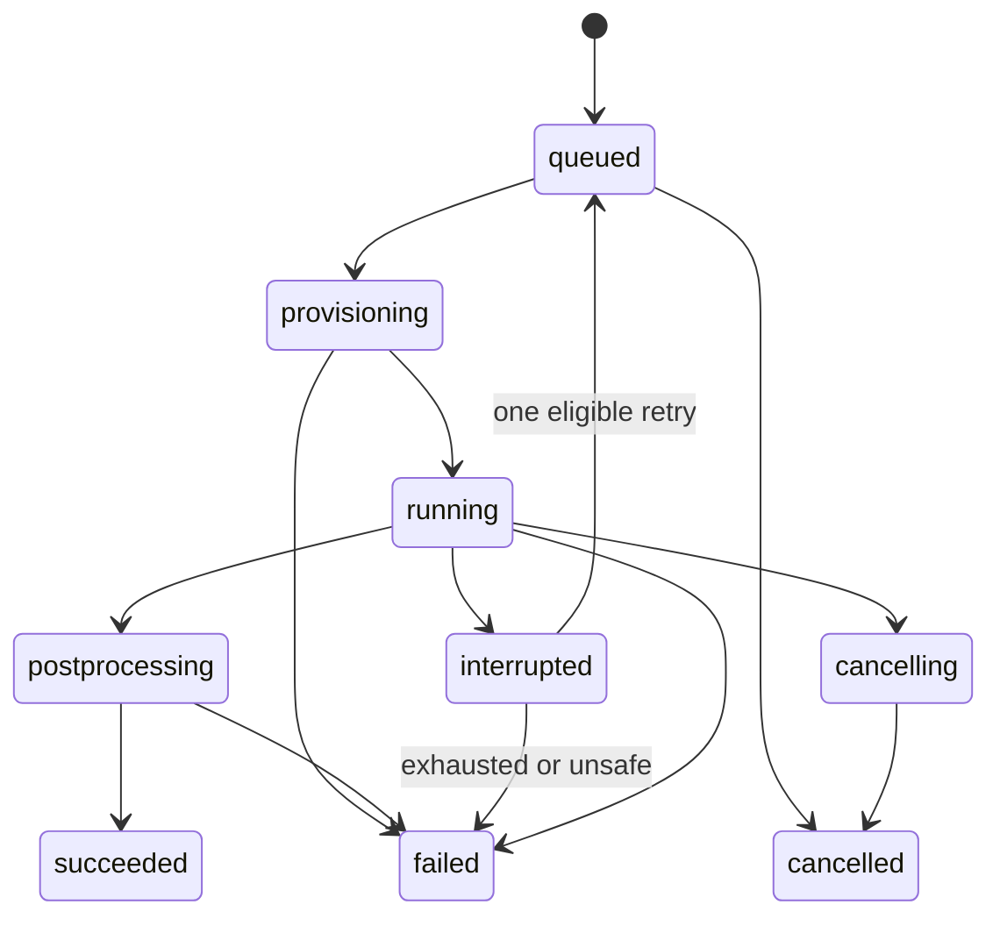

# API and job contract

Version prefix /api/v1. This is a design contract; generate OpenAPI during implementation. Session cookies with CSRF protection for mutations, owner checks on every lookup, pagination and request size limits. JSON errors: code, message, field_errors, retryable, request_id. Never return stack traces or filesystem paths.

## Implemented T007 slice

The generated OpenAPI/TS contracts now include real local session, project CRUD, geometry metadata reads and draft analysis creation/read/name-edit/history routes. All other routes below remain design targets. See [local API usage](PERSISTENCE.md), [ADR-015](adr/ADR-015.md) and [T007 evidence](validation/T007.md).

GET `/session` sets the local HttpOnly SameSite=Strict cookie and returns the persistent owner/CSRF token. Owned routes require that cookie; mutations also require `X-CSRF-Token`. APIKey cookie security and the CSRF header appear in OpenAPI. Loopback peer/Host and browser Origin checks apply even to session/health/docs. Foreign origins and cross-site fetches are rejected. Sessions expire when the API process restarts; metadata persists. Hosted modes/local bypass remain disabled.

Project PATCH/DELETE and analysis PATCH require `If-Match: "<revision>"`; absent is 428, malformed 422, stale 409. GET/create/edit return ETags. POST `/projects/{id}/analyses` requires the project ETag but does not increment it. Project metadata edits and trusted internal geometry registration increment the project revision; analysis edits increment only that analysis. Draft geometry may be null; a supplied reference must belong to the same owned nondeleted project. Name-only edits append immutable history; GET `/analyses/{id}/revisions/{revision}` reads it. Duplication/engineering settings/run snapshots remain later tasks.

GET `/projects/{id}/geometry` and `/geometry/{revision}` read immutable metadata. There is no public registration/upload/import endpoint until T008 validates artifact bytes/native CAD. Project DELETE tombstones access to the project and children; actual job cancellation/purge awaits the job implementation. Lists return items/total/offset/limit (default 50, maximum 100). POST/PATCH/PUT metadata requests require Content-Length and are bounded to 64 KiB before parsing (411/413). Unknown fields are rejected; body/path/SQL details are not echoed in errors.

## Planned service routes

| Method and route | Behavior |
|---|---|
| POST /projects; GET /projects | Create/list own projects |
| GET/PATCH/DELETE /projects/{id} | Authorized details, revision-guarded edit, tombstone/cancel |
| POST /projects/{id}/geometry-uploads | Constrained STEP upload ticket with checksum/size ceiling |
| POST /projects/{id}/geometry-imports | Queue validated import from completed owned upload |
| POST /geometry/{revision}/edits | Preview repair/defeaturing in a copy |
| POST /geometry/{revision}/edit-commits | Commit a verified preview with parent revision check |
| POST /projects/{id}/analyses | New analysis pinned to geometry revision |
| GET/PATCH /analyses/{id} | Typed settings; If-Match revision required on mutation |
| POST /analyses/{id}/duplicate | Duplicate immutable references and editable state |
| GET /analyses/{id}/preflight | Structured blockers, warnings and selected-geometry checks |
| POST /analyses/{id}/estimates | Stage, revision and resource plan -> expiring estimate/rate ID |
| POST /analyses/{id}/mesh-jobs | Estimate ID, revision, cap, idempotency key -> reservation/job |
| POST /analyses/{id}/runs | Frozen mesh+analysis revision, estimate/cap -> run/job |
| GET /jobs/{id}; GET /jobs/{id}/events | Durable state; SSE with event IDs or polling fallback |
| POST /jobs/{id}/cancel | Idempotent request; consumption stops on actual termination |
| GET /runs/{id}/results | Manifest of authorized fields/location types and expiry |
| POST /runs/{id}/sections | Bounded server-side slice request; cache by plane/run/field |
| POST /runs/{id}/reports | Selected views, format, user conclusion, immutable report request |
| POST /projects/{id}/exports | Portable archive options; owner rechecked when download issued |
| POST /archive-imports | Safe archive import into a new private project |
| GET /usage; GET /allowance | Actual, credited, reserved and remaining quantities separately |
| POST /admin/allowances | Operator allocation only, no implicit project-content access |

Use 409 for stale revision/idempotency payload conflict, 422 for invalid engineering setup, 403 for forbidden action, 404 for inaccessible object where appropriate, 429 for quotas. An estimate is not permission to execute and becomes stale when inputs/resources/rate version change. A duplicate idempotency key with same payload returns original job; a different payload conflicts.

## State transitions

Terminal jobs cannot become running again; retry creates a new Attempt beneath the same logical Job and changes job state under a guarded transaction. Stage-specific statuses include budget_exceeded, resource_exceeded and invalid_model as failure reasons. Failed postprocessing is a platform failure; retry postprocessing without rerunning CCX when raw artifacts are sound.
A compute watchdog uses monotonic elapsed time, reserved rate, termination latency and startup margin. Cancellation is “requested” until process/instance death is confirmed. Terminal successful state requires validated output manifest and atomic usage finalization. SSE disconnect is not a job-state transition.

## Worker protocol

Authenticated claim/heartbeat/artifact-publish/complete endpoints are distinct from user API. Job-scoped token limits allowed artifact prefixes, maximum bytes, lease and expiration. Worker egress only to regional artifact/control endpoints, with solver subprocess network denied. Heartbeat loss triggers fencing and infrastructure inspection; never blindly double-start. Finalization and usage emission are idempotent.
