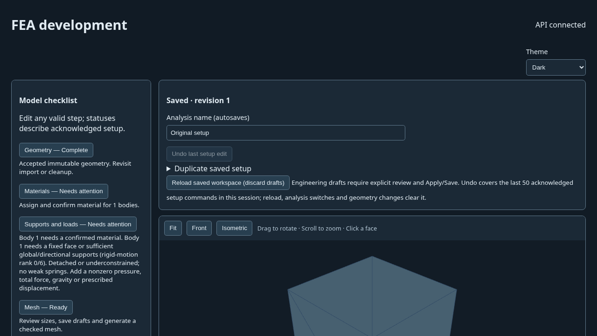
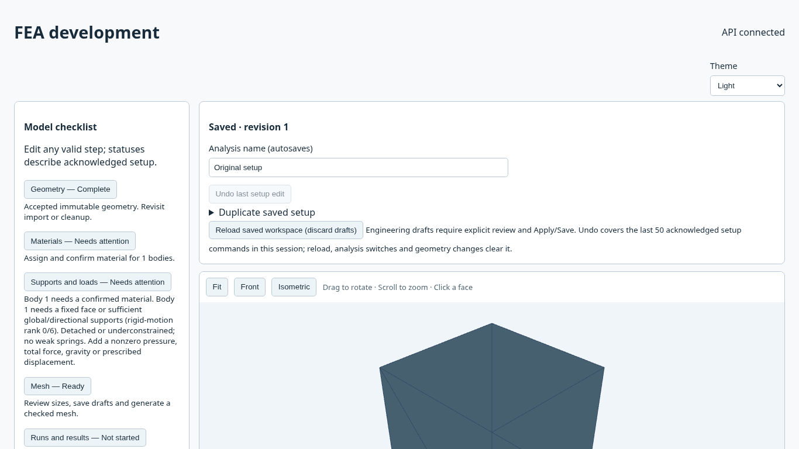
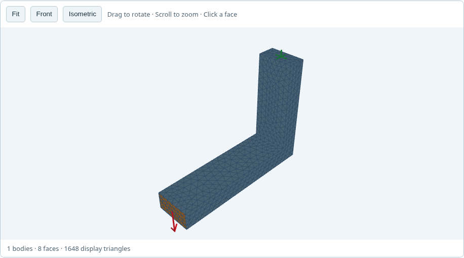
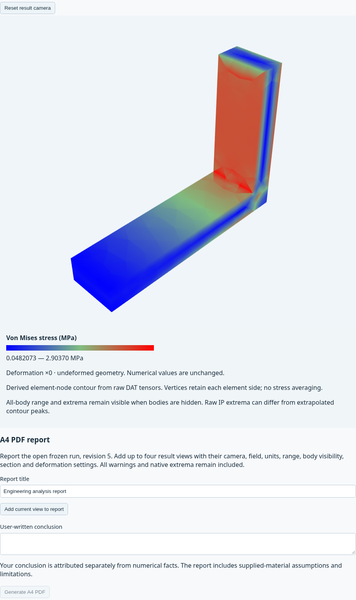
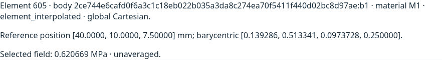
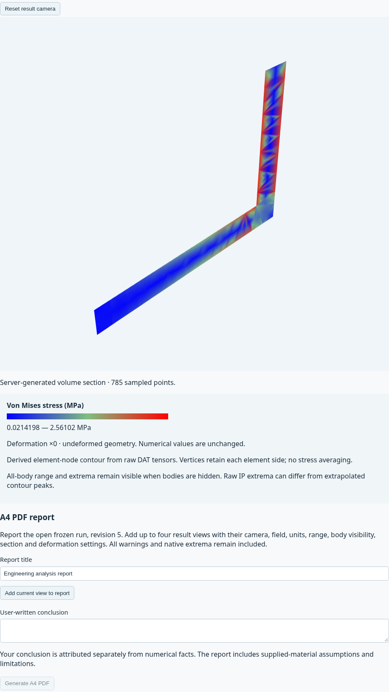
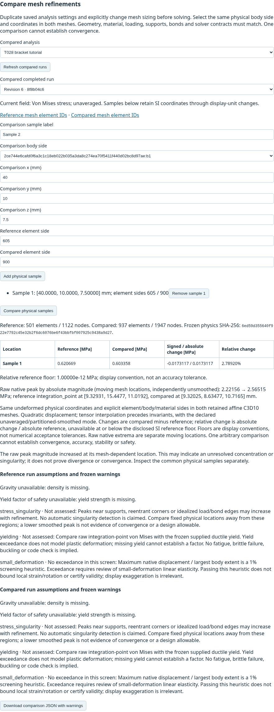
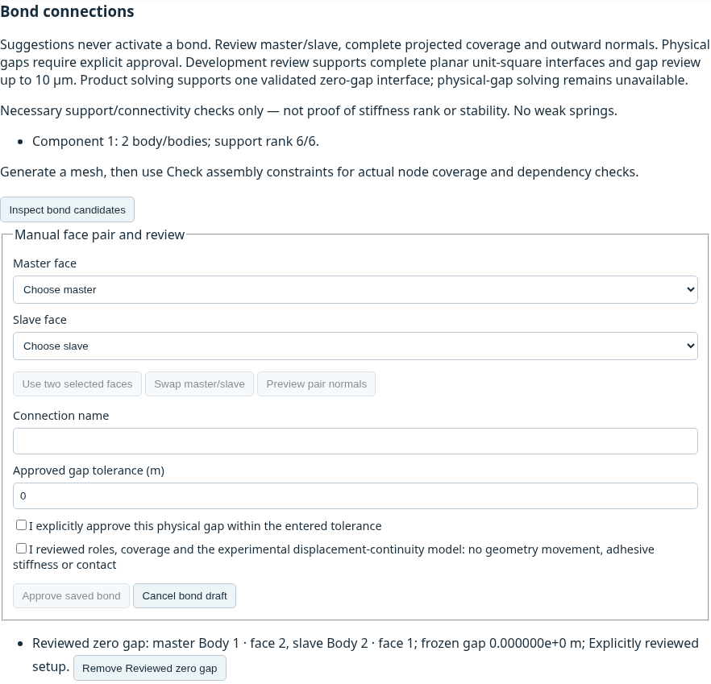
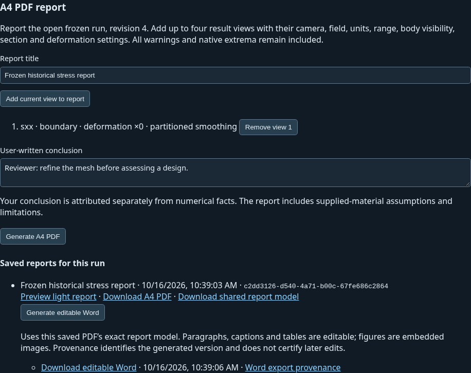
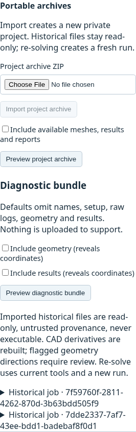

# UI and feature reference — T030

These **24 actual screenshots** come from nine passing native-backed Linux Chromium workflows at commit `743e1f3fbf8f2b01a00195466f9ccb754fdcd304`. They show synthetic bracket/bond examples, real CCX fields, probes/sections/refinement, PDF/editable Word export, portable archives and both themes. Each original PNG has browser/platform/viewport/theme/WebGL-renderer metadata and a SHA-256 digest. Captures use SwiftShader software rendering; they do not establish target-laptop GPU performance, Windows Chrome/Edge acceptance or human usability. **M4 acceptance is pending**; see [the local packet](LOCAL_ACCEPTANCE.md) and [engineering limits](validation/M4-owner-review.md).

The examples are not a safe-design certificate. Product solves remain ≤3,000 affine/planar C3D10 elements, with two-body bonding limited to one full axis-aligned zero-gap unit-square interface and ≤65 trace nodes per side. PDF figures stay light for readability; Word paragraphs/tables are editable, with embedded figures. Original archive history remains inert.

## Workspace and themes

Acknowledged save state, guided checklist and missing-material/support blockers are visible. These images show a setup awaiting material confirmation.

## Bracket mesh and calculated stress

The actual quadratic mesh includes physical support/load arrows. The selected fine-run von Mises contour retains its units, range and unaveraged element-side semantics.

## Physical inspection and refinement

Probes use a physical point and element side; volume sections come from the server's quadratic volume field. Refinement compares the same physical location on both meshes and does not certify convergence.

## Deliberately reviewed bonded connection

The saved zero-gap pair is visible below the review form. A suggestion alone never activates a bond. General physical-gap/contact solving stays unavailable.

## Reports and archives

The same saved historical report provides its PDF, shared model and editable Word download. Portable imports expose original history as read-only attachments. Diagnostic geometry/results are opt-in and previewed before download.

## All full-resolution captures

Click a screenshot title for the original image. Metadata describes what was actually captured; the automated learning log is not a human participant record.

| Full screenshot | Capture metadata |
|---|---|
| [Diagnostic preview with geometry and results excluded](validation/results/T030/ui/archive-01-diagnostics.png) | [archive-01-diagnostics.json](validation/results/T030/ui/archive-01-diagnostics.json) |
| [Portable project archive preview](validation/results/T030/ui/archive-02-portable.png) | [archive-02-portable.json](validation/results/T030/ui/archive-02-portable.json) |
| [Reimported project with inert historical downloads](validation/results/T030/ui/archive-03-restored.png) | [archive-03-restored.json](validation/results/T030/ui/archive-03-restored.json) |
| [bond: geometry, material and face loads](validation/results/T030/ui/bond-01-setup.png) | [bond-01-setup.json](validation/results/T030/ui/bond-01-setup.json) |
| [Reviewed zero-gap bond](validation/results/T030/ui/bond-02-connections.png) | [bond-02-connections.json](validation/results/T030/ui/bond-02-connections.json) |
| [bond: real quadratic mesh preview](validation/results/T030/ui/bond-03-mesh.png) | [bond-03-mesh.json](validation/results/T030/ui/bond-03-mesh.json) |
| [bond: native result field](validation/results/T030/ui/bond-04-results.png) | [bond-04-results.json](validation/results/T030/ui/bond-04-results.json) |
| [bond: physical element-owned probe](validation/results/T030/ui/bond-05-probe.png) | [bond-05-probe.json](validation/results/T030/ui/bond-05-probe.json) |
| [bond: authoritative volume section](validation/results/T030/ui/bond-06-section.png) | [bond-06-section.json](validation/results/T030/ui/bond-06-section.json) |
| [bond: two-mesh physical comparison](validation/results/T030/ui/bond-07-refinement.png) | [bond-07-refinement.json](validation/results/T030/ui/bond-07-refinement.json) |
| [bond: saved PDF report and immutable run](validation/results/T030/ui/bond-08-report.png) | [bond-08-report.json](validation/results/T030/ui/bond-08-report.json) |
| [bond: guided tutorial and learning log](validation/results/T030/ui/bond-09-tutorial.png) | [bond-09-tutorial.json](validation/results/T030/ui/bond-09-tutorial.json) |
| [bracket: geometry, material and face loads](validation/results/T030/ui/bracket-01-setup.png) | [bracket-01-setup.json](validation/results/T030/ui/bracket-01-setup.json) |
| [bracket: real quadratic mesh preview](validation/results/T030/ui/bracket-03-mesh.png) | [bracket-03-mesh.json](validation/results/T030/ui/bracket-03-mesh.json) |
| [bracket: native result field](validation/results/T030/ui/bracket-04-results.png) | [bracket-04-results.json](validation/results/T030/ui/bracket-04-results.json) |
| [bracket: physical element-owned probe](validation/results/T030/ui/bracket-05-probe.png) | [bracket-05-probe.json](validation/results/T030/ui/bracket-05-probe.json) |
| [bracket: authoritative volume section](validation/results/T030/ui/bracket-06-section.png) | [bracket-06-section.json](validation/results/T030/ui/bracket-06-section.json) |
| [bracket: two-mesh physical comparison](validation/results/T030/ui/bracket-07-refinement.png) | [bracket-07-refinement.json](validation/results/T030/ui/bracket-07-refinement.json) |
| [bracket: saved PDF report and immutable run](validation/results/T030/ui/bracket-08-report.png) | [bracket-08-report.json](validation/results/T030/ui/bracket-08-report.json) |
| [bracket: guided tutorial and learning log](validation/results/T030/ui/bracket-09-tutorial.png) | [bracket-09-tutorial.json](validation/results/T030/ui/bracket-09-tutorial.json) |
| [Light report preview from a dark workspace](validation/results/T030/ui/report-01-light.png) | [report-01-light.json](validation/results/T030/ui/report-01-light.json) |
| [PDF and editable Word from the same frozen model](validation/results/T030/ui/report-02-word.png) | [report-02-word.json](validation/results/T030/ui/report-02-word.json) |
| [Dark workspace with selectable imported geometry](validation/results/T030/ui/workspace-01-dark.png) | [workspace-01-dark.json](validation/results/T030/ui/workspace-01-dark.json) |
| [Light workspace, units, model tree and checklist](validation/results/T030/ui/workspace-02-light.png) | [workspace-02-light.json](validation/results/T030/ui/workspace-02-light.json) |
